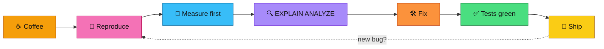

<div align="center">



# Hi, I'm Ketleen 👋

[](https://github.com/KetleenAnne)

[](#-english)
[](#-português)
[](#-projects)
[](#-beyond-the-code--além-do-código)
[](https://www.linkedin.com/in/ketleenannefaria/)


</div>

## ⚡ Quick look

| ☕ Back-end | 🐘 Database | 🤖 AI in my workflow | 🎓 Education |
|:---:|:---:|:---:|:---:|
| Java · Spring Boot · JPA/Hibernate · REST | PostgreSQL · indexes · `EXPLAIN ANALYZE` · migrations | Claude · GitHub Copilot · agent tooling | UFJF · Computer Science · Exact Sciences |


## 🇬🇧 English

I'm a **Mid-Level Back-End Java Developer** working in health tech. I build end-to-end features, from data modeling and APIs to reports and UI, with a focus on database performance, code quality, and applying AI to real products.

### 🔎 What I do
- 🧱 **Back-end** with Java, Spring Boot, Spring Data JPA, Hibernate and PostgreSQL
- 🐘 **Database design and performance**: execution plans, indexes, query rewriting, migrations
- 🧪 **Automated testing** with JUnit and Mockito, and active code review
- 🎨 **Full-stack** when needed, with React and TypeScript
- 🤖 **AI in my daily workflow**: I use AI agents (Claude) and GitHub Copilot to plan, implement, test, debug, and document, and I build tooling that lets agents work with the product

### ⚙️ My debugging loop

> Rule #1: **measure before optimizing.**

### 🎓 Education
- 🎓 **B.Sc. in Computer Science**, Federal University of Juiz de Fora (UFJF), expected Jul 2027
- 🔬 **B.Sc. in Exact Sciences (Computing focus)**, UFJF, completed Jul 2026

### 💼 Experience
- 🏥 **Tabia Health**: Mid-Level Back-End Developer (2026 – present); Software Developer (2024 – 2026); Web Development Intern (2022 – 2024)
- 🚂 **MRS Logística**: Development Intern (2022)


## 🇧🇷 Português

Sou **Desenvolvedora Back-End Java Pleno** em tecnologia para saúde. Entrego features de ponta a ponta, da modelagem de dados e das APIs até relatórios e interface, com foco em performance de banco, qualidade de código e IA aplicada a produtos reais.

### 🔎 O que eu faço
- 🧱 **Back-end** com Java, Spring Boot, Spring Data JPA, Hibernate e PostgreSQL
- 🐘 **Modelagem e performance de banco**: planos de execução, índices, reescrita de consultas, migrações
- 🧪 **Testes automatizados** com JUnit e Mockito, e code review ativo
- 🎨 **Full-stack** quando preciso, com React e TypeScript
- 🤖 **IA no dia a dia**: uso agentes de IA (Claude) e GitHub Copilot para planejar, implementar, testar, investigar bugs e documentar, e construo ferramentas que permitem a agentes trabalharem com o produto

### ⚙️ Meu ciclo de debug
> ☕ café → 🐛 reproduzir → 📏 **medir primeiro** → 🔍 `EXPLAIN ANALYZE` → 🛠️ corrigir → ✅ testes verdes → 🚀 publicar

### 🎓 Formação
- 🎓 **Bacharelado em Ciência da Computação**, UFJF, conclusão prevista jul/2027
- 🔬 **Bacharelado em Ciências Exatas (ênfase em Computação)**, UFJF, concluído jul/2026

### 💼 Experiência
- 🏥 **Tabia Health**: Desenvolvedora Back-End Pleno (2026 – atual); Software Developer (2024 – 2026); Estagiária de Desenvolvimento Web (2022 – 2024)
- 🚂 **MRS Logística**: Estagiária Desenvolvedora (2022)


## 🧰 Stack

**☕ Back-end** &nbsp;    

**🐘 Database** &nbsp;   

**🧪 Quality** &nbsp;   

**🎨 Front-end** &nbsp;  

**🤖 AI & Tools** &nbsp;     


## 🚀 Projects

Small, public projects built to show how I work (synthetic data only, no company code) · Projetos pequenos e públicos, feitos para mostrar como eu trabalho (só dados sintéticos, nenhum código de empresa).

| Project · Projeto | What it shows · O que mostra | Status |
|---|---|---|
| 🐘 [`postgres-query-optimization`](https://github.com/KetleenAnne/postgres-query-optimization) | 4 slow queries → `EXPLAIN ANALYZE` → fix → measured before/after (up to ~300x) · 4 consultas lentas → correção → antes e depois medidos |  |
| 🤖 [`ai-bug-triage-api`](https://github.com/KetleenAnne/ai-bug-triage-api) | LLM inside a Spring Boot backend, with validation, fallback and tests · LLM em um backend Spring Boot, com validação, fallback e testes |  |


## ☕📚🐱 Beyond the code · Além do código

```
  /\_/\      Gael status:  purring
 ( o.o )     coffee:       refilling
  > ^ <      books:        always one more on the pile
```

<div align="center">
  
</div>

<details>
<summary>📚 <b>biblioKet</b>: lendo agora e próximos · reading now &amp; next (click to open)</summary>

**🎓 Studying now · Estudando agora:** Clean Code, TDD, SOLID, System Design, Design Patterns

<!-- SHELF:START -->

**📖 Reading now · Lendo agora**
- _1984_ — George Orwell
- _A revolução dos bichos_ — George Orwell
- _Crime e Castigo_ — Fiódor Dostoiévski

**🔖 Next up · Próximos**
- _Clean Code_ — Robert C. Martin · Readable code · Código legível
- _The Pragmatic Programmer_ — Andrew Hunt & David Thomas · Craft and habits · Ofício e hábitos
- _Effective Java_ — Joshua Bloch · Java done right · Java do jeito certo
- _Refactoring_ — Martin Fowler · Improving existing code · Melhorar código existente
- _Test-Driven Development: By Example_ — Kent Beck · Tests first · Testes primeiro

**✅ Read · Lidos (3)**
- _Capitães da Areia_ — Jorge Amado
- _Noites Brancas_ — Fiódor Dostoiévski
- _A Rainha Vermelha_ — Victoria Aveyard

📚 [biblioKet: lista completa · full list (52 livros)](data/books.md)

<!-- SHELF:END -->

💡 [Sugira um livro para a biblioKet · Suggest a book](https://github.com/KetleenAnne/KetleenAnne/issues/new?template=sugerir-livro.yml)

<sub>The shelf and this list update themselves from [`data/books.md`](data/books.md) · A estante e esta lista se atualizam sozinhas a partir de [`data/books.md`](data/books.md)</sub>

</details>

<details>
<summary>☕ <b>Coffee &amp; cats corner · Cantinho do café e dos gatos</b></summary>

- ☕ Powered by coffee · Movida a café
- 🐱 Cat person, proudly · Time gato, com orgulho
- 🐾 **Gael** is my cat and my unofficial code reviewer (he approves everything that has treats) · **Gael** é meu gato e meu revisor de código não oficial (aprova tudo que tem petisco)

</details>


<div align="center">

### 🌐 Contact · Contato

[](https://www.linkedin.com/in/ketleenannefaria/)
[](mailto:ketleenanne.faria@gmail.com)

</div>

### Github Stats

<br> 
 <div>
  <a href="https://github.com/KetleenAnne">

  
  </a>
</div>
