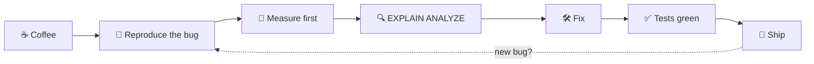

<div align="center">


# Hi, I'm Ketleen 👋

[](https://github.com/KetleenAnne)


[🇬🇧 English](#-english) · [🇧🇷 Português](#-português)

</div>

---

## 🇬🇧 English

I'm a **Mid-Level Back-End Java Developer** working in health tech. I build end-to-end features, from data modeling and APIs to reports and UI, with a focus on database performance, code quality, and applying AI to real products.

### 🔎 What I do
- Back-end with **Java, Spring Boot, Spring Data JPA, Hibernate** and **PostgreSQL**
- Database design and performance: execution plans, indexes, query rewriting, migrations
- Automated testing with **JUnit** and **Mockito**, and active code review
- Full-stack when needed, with **React and TypeScript**
- **AI in my daily workflow**: I use AI agents (Claude) and GitHub Copilot to plan, implement, test, debug, and document, and I build tooling that lets agents work with the product

### ⚙️ My debugging loop

> Rule #1: **measure before optimizing.**

### 🎓 Education
- **B.Sc. in Computer Science**, Federal University of Juiz de Fora (UFJF), expected Jul 2027
- **B.Sc. in Exact Sciences (Computing focus)**, UFJF, completed Jul 2026

### 💼 Experience
- **Tabia Health**: Mid-Level Back-End Developer (2026 – present); Software Developer (2024 – 2026); Web Development Intern (2022 – 2024)
- **MRS Logística**: Development Intern (2022)

### 🚀 Projects
Small, public projects built to show how I work (synthetic data only, no company code):

| Project | What it shows | Status |
|---|---|---|
| `postgres-performance-lab` | Slow query → `EXPLAIN ANALYZE` → fix → measured before/after | 🛠️ coming soon |
| AI bug triage API | Integrating an LLM into a Spring Boot backend, with tests | 🛠️ coming soon |

---

## 🇧🇷 Português

Sou **Desenvolvedora Back-End Java Pleno** em tecnologia para saúde. Entrego features de ponta a ponta, da modelagem de dados e das APIs até relatórios e interface, com foco em performance de banco, qualidade de código e IA aplicada a produtos reais.

### 🔎 O que eu faço
- Back-end com **Java, Spring Boot, Spring Data JPA, Hibernate** e **PostgreSQL**
- Modelagem e performance de banco: planos de execução, índices, reescrita de consultas, migrações
- Testes automatizados com **JUnit** e **Mockito**, e code review ativo
- Full-stack quando preciso, com **React e TypeScript**
- **IA no dia a dia**: uso agentes de IA (Claude) e GitHub Copilot para planejar, implementar, testar, investigar bugs e documentar, e construo ferramentas que permitem a agentes trabalharem com o produto

### ⚙️ Meu ciclo de debug
> ☕ café → 🐛 reproduzir o bug → 📏 **medir primeiro** → 🔍 `EXPLAIN ANALYZE` → 🛠️ corrigir → ✅ testes verdes → 🚀 publicar

### 🎓 Formação
- **Bacharelado em Ciência da Computação**, UFJF, conclusão prevista jul/2027
- **Bacharelado em Ciências Exatas (ênfase em Computação)**, UFJF, concluído jul/2026

### 💼 Experiência
- **Tabia Health**: Desenvolvedora Back-End Pleno (2026 – atual); Software Developer (2024 – 2026); Estagiária de Desenvolvimento Web (2022 – 2024)
- **MRS Logística**: Estagiária Desenvolvedora (2022)

### 🚀 Projetos
Projetos pequenos e públicos, feitos para mostrar como eu trabalho (só dados sintéticos, nenhum código de empresa):

| Projeto | O que mostra | Status |
|---|---|---|
| `postgres-performance-lab` | Consulta lenta → `EXPLAIN ANALYZE` → correção → antes e depois medidos | 🛠️ em breve |
| API de triagem de bugs com IA | Integração de um LLM em um backend Spring Boot, com testes | 🛠️ em breve |

---

## ☕📚🐱 Beyond the code · Além do código

```
  /\_/\      Gael status:  purring
 ( o.o )     coffee:       refilling
  > ^ <      books:        always one more on the pile
```

<details>
<summary>📚 <b>Bookshelf · Estante</b> (click to open)</summary>

- 📖 **Studying now · Estudando agora:** Clean Code, TDD, SOLID, System Design, Design Patterns
- 🔖 **Next on the list · Próximos:** _(add your picks)_
- 💡 Recommendations welcome! · Indicações são bem-vindas!

</details>

<details>
<summary>☕ <b>Coffee &amp; cats corner · Cantinho do café e dos gatos</b></summary>

- ☕ Powered by coffee · Movida a café
- 🐱 Cat person, proudly · Time gato, com orgulho
- 🐾 **Gael** is my cat and my unofficial code reviewer (he approves everything that has treats) · **Gael** é meu gato e meu revisor de código não oficial (aprova tudo que tem petisco)

</details>

---

### 🌐 Contact · Contato
- LinkedIn: [Ketleen Anne Faria](https://www.linkedin.com/in/ketleenannefaria/)
- E-mail: ketleenanne.faria@gmail.com

### 🧰 Tools & Technologies

<div style="display: inline_block">
  <h5>Programming Languages</h5>
  
  
  
  
  
</div>

<div style="display: inline_block">
 <h5>Frameworks and Libraries</h5>
  
  
  
  
  
</div>

<div style="display: inline_block">
  <h5>Web Development</h5>
  
  
</div>

<div style="display: inline_block">
  <h5>Databases</h5>
  
</div>

<div style="display: inline_block">
   <h5>Tools and Platforms</h5>
  
  
  
  
</div>

### Github Stats

<br> 
 <div>
  <a href="https://github.com/KetleenAnne">
   
  
</div>
